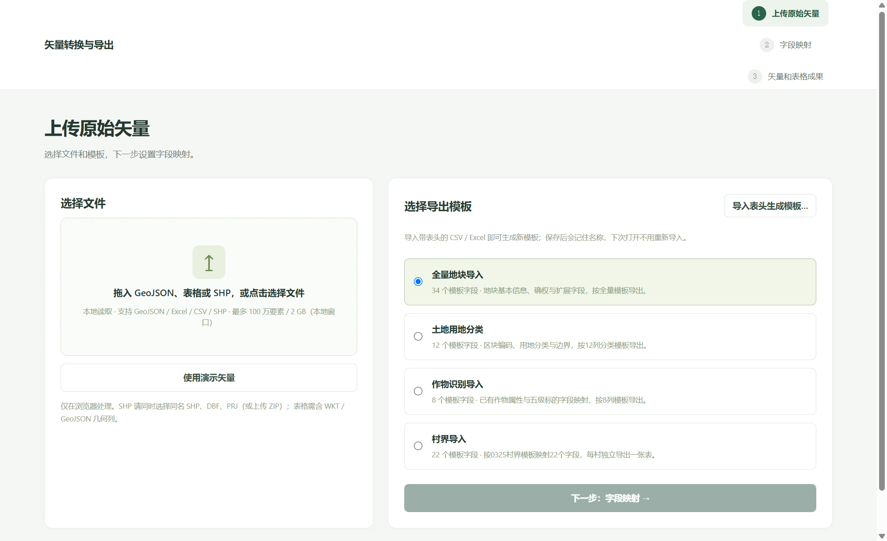

# 矢量转换：原始矢量 → 字段映射 → 矢量和表格

当前主流程只有三页。旧版字段分级、独立质检、三表预览、选列导出已退出主流程，历史页面与服务暂保留在源码中用于回归，旧路由统一返回上传页。

## 启动

需要 Node.js 22.12+。

```sh
npm install
npm run dev
npm test
npm run build
npm run preview
```

默认地址 http://127.0.0.1:5173 。技术栈为 Vite、Vue 3、TypeScript、Tailwind CSS 4、Pinia、Vue Router、Leaflet、SheetJS；全部计算在浏览器（本地窗口内是 WebView2）里完成，不联网。

本工具只做字段映射与格式转换，**不再做矢量拓扑检查**：重叠、缝隙、岛洞等几何原样透传，既不修复也不拦截。需要先修拓扑时，用配套的图斑拓扑检查与修复工具处理原始数据，再回到这里导入。

## 免安装 EXE（分享用）

`desktop/` 把 `npm run build` 的产物封装成一个单文件 Windows 程序：双击得到一个原生窗口（WebView2），
页面、示例数据、Web Worker 全部在本地，不开浏览器、不联网、不需要 Node.js。

```powershell
.\.venv\Scripts\python.exe desktop\build_exe.py --web     # 构建前端 + 打包 + 自检
```

产物 `release\矢量转换与导出_v0.1.4.exe`，自检 9 项全通过才算成功；细节见 [desktop/README.md](desktop/README.md)。



## 模板：新增字段、导入表头、保存复用

内置的四套模板可以直接改，也可以另存成自己的模板，全部存在本机浏览器存储里，下次打开自动恢复上次选用的模板。

1. **新增字段**：映射页工具条点「+ 新增字段」，出现在表格末尾，改名后即生效；每个字段都能改名，也能删除（至少保留一个）。
2. **修改字段内容**：来源下拉选「固定值（手填文本）…」，输入框里写的内容会写进每一行；随时可以「改回字段映射」。固定值和字段映射一样按模板保存。
3. **导入表头生成模板**：上传页点「导入表头生成模板…」，选带表头的 `.csv` / `.xlsx`/`.xls`（也支持 `.txt` 逗号分隔）。首个非空行即表头，会跳过前面的标题行；重名列自动加 `(2)`，最多 200 列。确认名称后即可使用。
4. **保存与命名**：映射页点「保存模板」，可写「模板名称」和「用途说明」，例如“某公司上传模板”。同名保存即覆盖，内置模板只能另存为自建模板（「保存为模板」）；自建模板还能重命名、删除、恢复内置默认。

字段名、固定值、模板名称与上次选用的模板都写在 `localStorage`（键前缀 `plot-import:v2:`），换浏览器或清理站点数据会丢失；导出成 EXE 后同样保存在 `%LOCALAPPDATA%\plot-import-desktop\webview` 对应的 WebView2 配置里。

## 处理顺序

1. **上传原始矢量**：选择 WGS84 经纬度 GeoJSON FeatureCollection，或者加载演示矢量。选择全量地块（34列）、土地用地分类（12列）、作物识别（8列）、村界导入（22列）模板。
2. **字段映射**：每个模板目标字段选择一个原始属性，也可以填固定值。允许将一个来源显式映射到不同目标；不提供自动确认的推荐。
3. **生成矢量和表格**：一次生成同一批属性结果，结果页下载 GeoJSON 与 Excel，两份成果行数、字段名、字段值相互对应。桌面窗口里点下载会弹系统「另存为」对话框，可自己选保存位置；网页版走浏览器下载。

当前支持本地读取 `.geojson` / `.json`、`.csv`、`.xlsx` / `.xls`，以及 SHP（选择同名 `.shp`、`.dbf`、`.prj`，或上传包含单个图层的 `.zip`），不上传服务器。表格必须包含 WKT 或 GeoJSON 几何列，SHP 会依据 PRJ 转为 WGS84；不直接解析 GPKG / CAD。CSV 会先自动识别编码再解析：带 BOM 的 UTF-8 / UTF-16 直接按 BOM 读，没有 BOM 时先严格按 UTF-8 试，失败退回 GBK / GB18030，所以国内导出的 GBK 表格不会变成乱码；上传成功的提示里会标出识别到的编码。处理上限按运行方式区分，见下表；超过上限会提示分批处理。

| 运行方式 | 单次数据量 | 单文件大小 |
| --- | --- | --- |
| 本地 EXE / 本地服务（?local=1） | 100 万个要素 | 2 GB |
| GitHub Pages 网页版 | 20 万个要素 | 200 MB |

本地窗口打开时自动带上 ?local=1，上传页会显示当前生效的上限；仍超过时可分批处理。读取与生成都是流式处理，规模变大主要是耗时变长，不再有拓扑检查这一道最慢的环节。

## 字段口径

- 每个目标字段初始为“不映射，留空”。**不套用旧配置默认值，不自动生成编号、行政区或权属信息。**
- 所有模板表头在每个 GeoJSON 要素 properties 中完整存在；未映射、来源缺失或空字符串输出 `null`。
- 源几何一直保留，不修改源文件。模板的“边界”属性如果没有映射也为 null；用户可显式选择“源矢量几何 → WKT”填充该属性。
- Excel 从生成后的矢量读取全部字段，按模板顺序输出。null 成为空单元格，但不删除表头；数字0和布尔false保留。
- 原始对象/数组属性若被显式映射，序列化为JSON文本，不猜测拆分规则。
- 不再在最后一步二次选列。四种模板分别输出34、12、8、22列；全量模板两行表头，其余一行。
- 证件、确权、作物等字段仅取源值，不推断或生成。作物识别模板功能不运行识别模型。
- 映射和生成结果按模板隔离，映射与固定值会记在本机（`localStorage`），重新上传会清空成果但保留配置；修改映射后当前模板旧成果立即失效。切换模板各自记住自己的映射。
- 固定值不是“自动生成”：写进每行的文本完全由用户输入，程序不补编号、行政区、面积。
- 模板字段名、列顺序、字段增删都会保存；内置模板的改动存在覆盖层里，「恢复内置默认」可退回原始表头。

## 不做拓扑检查

上传的几何原样写进成果：重叠、缝隙、自相交、岛洞、空几何都不会被拦截、裁剪或修复，也不做吸附、坐标转换或平台专有规则校验。映射页只保留一份地块预览，用于核对属性和位置。

需要几何质量把关时，先用配套的图斑拓扑检查与修复工具（重叠裁剪/合并、小面积清理、岛洞处理、多部件拆分）处理源数据，再来这里生成上传成果。

## 当前代码入口

- `views/FlowUploadView.vue`：文件读取、模板选择、导入表头生成模板。
- `views/FlowMappingView.vue`：目标字段映射、固定值、字段增删改名、地块预览。
- `views/FlowOutputView.vue`：双成果与共同属性预览。
- `stores/templateStore.ts`：内置模板覆盖层 + 自建模板库（命名保存、重命名、删除、恢复默认）。
- `services/templateImport.ts`：读 CSV/Excel 表头生成模板定义。
- `utils/textEncoding.ts`：CSV 字节解码，按 BOM → UTF-8 → GBK/GB18030 顺序识别，供导入与表头解析共用。
- `stores/simpleFlowStore.ts`：本次源数据、各模板映射与固定值、成果。
- `services/simplePipeline.ts`：源数据验证、严格空值转换、固定值写入、标准矢量与表格行。
- `utils/saveFile.ts`：下载统一入口；桌面窗口里交给 `window.pywebview.api.save_file`（壳子弹「另存为」），网页版退回浏览器下载。
- `public/mock/flow-demo.geojson`：可完成新流程的合成示例，无真实个人资料。
- 原三种模板定义来自 `template-columns.json`、`templates/land-classification.json`、`templates/crop-recognition.json`，保留实际表头与换行。

## GitHub Pages

使用 Hash 路由；静态资源、mock、Worker均由Vite处理子路径。

将 `.env.example` 复制为 `.env.local`，设置 `VITE_BASE_PATH=/仓库名/` 后构建；项目根站点使用 `/`。

提供的 `.github/workflows/deploy.yml` 需放到Git仓库根的 `.github/workflows/` 才会执行。该工作流按项目位于仓库内 `plot-import-web/` 配置；独立仓库需将 working-directory 改为 `.`、cache-dependency-path 改为 `package-lock.json`、上传路径改为 `dist`，并调整 push paths。Pages设置选择 GitHub Actions。

本项目未自动发布。仅发布 dist，不把用户业务矢量放入 public。

## 村界映射与每村一表（0325模板）

新增“村界导入”模板，22列名称与顺序读取自提供的 GB18030 CSV，仅提取表头，不复制业务数据。标准矢量继续保留完整字段，未映射字段为 null，Excel为空单元格。

- 默认以映射后的“行政区划编码”作为村标识，也可选择原始矢量中的唯一村标识字段。这个原始字段只参与分组，不回填任何未映射的输出列。
- 每个村一个独立 XLSX 文件，一行对应一个源要素。同村多面/多要素保留多行，不自动溶解边界，不汇总人口、农户或面积。
- 同名但不同编码的村分别输出；同一分组若对应多个行政区划编码或村名，提示修正分组。村标识缺失会阻止生成，避免混村或丢行。
- 结果页提供逐村表格、逐村 GeoJSON、全部村表 ZIP、按村预览；不将各村混入一个总表。页面顶部的矢量下载仍可下载全部村界要素。
- 村表采用22列模板导出 XLSX；输入参照模板为 CSV，不代表要求输出相同编码的 CSV。
- 选择村界模板后可加载 `public/mock/village-demo.geojson`，其中合成甲村2个要素、乙村1个要素。建议映射 VILL_CODE→行政区划编码、VILL_NAME→村、源几何→地块坐标集，其他字段按需映射或留空。
- 模板定义：`public/mock/templates/village-boundary.json`；分组规则：`services/villageExport.ts`；ZIP导出：`utils/villageExcel.ts`。

## CSV 表格导出

结果页可选择 Excel（.xlsx）或 CSV（UTF-8 BOM），四种模板均支持。村界逐村下载及 ZIP 打包使用同一格式设置，CSV 时每村一个 `.csv`。

CSV 按模板顺序输出单行完整字段表头（不含 Excel 分组行），保留所有空列；逗号、双引号、换行和 WKT 按 CSV 引号规则处理，行结束使用 CRLF。中文文件采用 UTF-8 BOM，不是原参照 CSV 的 GB18030 编码。

CSV 本身没有单元格类型，文件保留编码前导零和原始长编号；Excel直接双击打开时可能自动转换，应使用“从文本/CSV”导入并将编号列设为文本，或选用 XLSX 保留文本类型。

## Streamlit 部署

新增 `streamlit_app.py` 与独立构建命令 `npm run build:streamlit`。完整部署、GitHub自动更新及权限说明见 [DEPLOY_STREAMLIT.md](DEPLOY_STREAMLIT.md)。当前部署目录按此项目作为独立仓库根配置；Pages工作流已改为仅手动触发，日常main推送使用Streamlit同步工作流。


CSV 导出编码可选择 UTF-8 BOM（默认）或 GBK（无 BOM），普通表格、逐村表格及批量 ZIP 共用所选编码。GBK 无法表示的字符会提示改用 UTF-8，避免静默丢字；Excel 和 GeoJSON 导出不受该选项影响。
